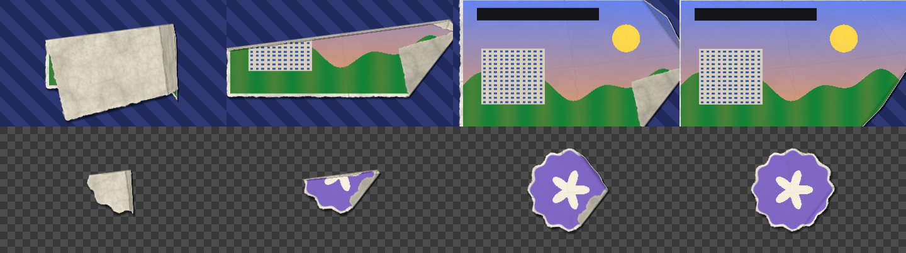

# MTTN PaperCraft Studio

> 🌐 [Español](README.md) | **English**

[](https://github.com/la-matatena/mttn-papercraft-studio/actions/workflows/ci-release.yml)
[](https://github.com/la-matatena/mttn-papercraft-studio/releases/latest)
[](LICENSE)
[](ofx/Info.plist)
[](docs/user_guide.md)
[](docs/developer_guide.md)
[](https://github.com/la-matatena)

**MTTN PaperCraft Studio** (by **[La Matatena](https://la-matatena.com)** · [@la-matatena](https://github.com/la-matatena)) adds organic stop-motion paper cutouts, torn cardstock borders, paper intro and outro animations, a paper fold-and-unfold transition, and 24-bit stereo paper Foley sound effects directly on the DaVinci Resolve 20 and 21 Edit pages without opening Fusion. Both DaVinci Resolve Free and DaVinci Resolve Studio run the native OpenFX 1.4 C++17 plugin without watermarks.



## Included deliverables

| Component | Package path | Purpose |
| :--- | :--- | :--- |
| Native OpenFX bundle | `PaperCraftStudioPro.ofx.bundle` | Native C++17 **Paper Cutout FX** effect and **Paper Fold & Unfold** transition for the Edit page (`MTTN PaperCraft Studio` category) |
| macOS OpenFX installer | `Install_PaperCraft_OpenFX_macOS.command` | Compiles Universal (`x86_64` + `arm64`) or native macOS OpenFX bundle, ad-hoc signs it, and installs to `/Library/OFX/Plugins` |
| macOS OpenFX uninstaller | `Uninstall_PaperCraft_OpenFX_macOS.command` | Removes the OpenFX plugin (system or `--user`) and the `.drfx` templates from DaVinci Resolve |
| Linux OpenFX installer | `install_linux_ofx.sh` | Installs `PaperCraftStudioPro.ofx.bundle` into the Linux OpenFX directory |
| Portable OpenFX source | `OpenFX_Source/` | Standalone C++17 source files and OpenFX 1.4 headers for macOS and Linux builds |
| Paper SFX library | `Paper_SFX/` (4 stereo WAV files) | Real recorded 48 kHz, 24-bit stereo paper Foley clips released into the public domain (`CC0` / `Public Domain`) |
| Docs & design | `docs/` (`user_guide.md`, `design_doc.md`, `developer_guide.md`) | End-user guide, developer build guide, and technical design architecture |
| Legacy `.drfx` templates | `MTTN_PaperCraft_Studio.drfx` / `Templates_Unpacked/` | Validated Fusion `MacroOperator` templates: the **Paper Cutout FX** effect and the **Paper Fold & Unfold** transition (a lighter three-panel letter fold), with La Matatena purple thumbnails |

## Documentation

Read the full documentation set for installation steps, Edit-page workflows, and engineering architecture:

- [User guide](docs/user_guide.md): Installation steps, the Edit-page Paper Cutout FX and Paper Fold & Unfold workflows, all Inspector parameters, Paper SFX mixing table, and troubleshooting.
- [Design document](docs/design_doc.md): Architecture overview, OpenFX 1.4 host integration, linear-time signed distance field pipeline, curated real Foley audio assets, and engineering trade-offs.
- [Developer and build guide](docs/developer_guide.md): Repository layout, standalone Linux and macOS compilation, and verification suites.

## Install the native Edit-page OpenFX plugin

### Install on macOS

Run DaVinci Resolve installed from the Blackmagic Design website rather than the Mac App Store edition, because Apple sandbox restrictions prevent the Mac App Store build from loading third-party OpenFX bundles in `/Library/OFX/Plugins`.

1. Download and extract `MTTN_PaperCraft_Studio_Full_Bundle.zip` from [GitHub Releases](https://github.com/la-matatena/mttn-papercraft-studio/releases/latest) (or clone this repository).
2. Double-click `Install_PaperCraft_OpenFX_macOS.command`, or run it from **Terminal** inside the extracted folder (type `cd `, drag the folder onto the Terminal window, and press Return). In the ZIP the script sits at the top of the folder; in a cloned repository it lives in `ofx/`:

   ```bash
   ./Install_PaperCraft_OpenFX_macOS.command        # Releases ZIP
   ./ofx/Install_PaperCraft_OpenFX_macOS.command    # cloned repository
   ```

   If you prefer user-level installation without administrator privileges, pass `--user` to install into `${HOME}/Library/OFX/Plugins`:

   ```bash
   ./Install_PaperCraft_OpenFX_macOS.command --user
   ```

3. Approve the macOS Command Line Tools prompt if `clang++` is not installed yet, then rerun `Install_PaperCraft_OpenFX_macOS.command`.
4. Restart DaVinci Resolve to scan the OpenFX bundle.

### Uninstall on macOS

1. Quit DaVinci Resolve.
2. Double-click `Uninstall_PaperCraft_OpenFX_macOS.command` (inside `ofx/` in a cloned repository). It removes the OpenFX plugin, whether you installed it system-wide or with `--user`, plus the optional `.drfx` templates. If the plugin is in `/Library/OFX/Plugins`, it asks for your administrator password.

   To preview what would be removed without deleting anything:

   ```bash
   ./Uninstall_PaperCraft_OpenFX_macOS.command --dry-run
   ```

3. Open DaVinci Resolve: the **MTTN PaperCraft Studio** category is gone. Clips that used these effects show them as missing; remove them from your timelines.

### Install on Linux

1. Extract `MTTN_PaperCraft_Studio_Full_Bundle.zip`.
2. Run the Linux OpenFX installer script:

   ```bash
   ./install_linux_ofx.sh
   ```

   Pass `--user` to install into `${HOME}/.local/share/OFX/Plugins` without root privileges, or `--dest CUSTOM_DIR` for a custom location:

   ```bash
   ./install_linux_ofx.sh --dest CUSTOM_DIR
   ```

3. Restart DaVinci Resolve to load the Edit-page OpenFX suite.

## Use MTTN PaperCraft Studio on the Edit page

The OpenFX bundle registers two tools in the **MTTN PaperCraft Studio** category:

- **Paper Cutout FX** (effect): open **Effects** > **Open FX** > **MTTN PaperCraft Studio** and drag it directly onto any timeline clip, title, transparent PNG, or green-screen shot.
- **Paper Fold & Unfold** (transition): open **Effects** > **Open FX** > **Transitions** > **MTTN PaperCraft Studio** and drag it onto an edit point like any transition.

### Unfold and fold with Paper Fold & Unfold

The transition mimics a printed sheet unfolding in stop-motion: the clip arrives as a folded paper packet, opens stage by stage while showing the paper back, creases, and shadow, and lands exactly on the clean clip. With **Fold Action** set to **Auto**, the transition picks what to do from where you place it:

| Where you place it | What Auto does |
| :--- | :--- |
| At the start of a clip (nothing before it) | The clip **unfolds** into view |
| At the end of a clip (nothing after it) | The clip **folds** up and leaves the frame |
| Between two full-frame clips | The incoming clip unfolds over the outgoing one |
| Between two clips with transparency (PNGs, titles) | The outgoing clip folds away, then the incoming clip unfolds |

To force a behavior, choose **Unfold Incoming Clip**, **Fold Outgoing Clip**, or **Fold Out, Then Unfold In**. Upper tracks (`V2+`) keep their transparency, so a PNG logo can unfold over the video on the track below. You can also apply **Paper Cutout FX** and **Paper Fold & Unfold** to the same clip: **Paper Cutout FX** defaults **Intro Style** and **Outro Style** to `None` so it won't fight timeline transitions, and **Paper Fold & Unfold** automatically detects the cutout to keep a single torn border and hand its 3D shadow directly into the cutout's resting shadow. The transition length on the timeline sets the speed, and **Stop-Motion Steps** sets how many distinct poses you see.

> [!NOTE]
> Version 3.0 removed the Paper Cutout FX generator and the **Paper Unfold**, **Paper Crumple**, and **Paper Rip Wipe** transitions. If an older project used them, DaVinci Resolve shows them as unavailable; remove them from the timeline. Version 3.1 adds **Paper Fold & Unfold** as a new transition (with a new identifier), and the **Paper Unfold (3D)** style of Paper Cutout FX now folds the cutout along real creases.

## Inspector controls reference

### Paper Cutout FX

| Section | Key controls | Behavior |
| :--- | :--- | :--- |
| **1. Media Source and Placement** | **Source Mode**, **Premultiplied Source Alpha**, **Media Scale**, **Media Position**, **Media Rotation** | Switches between timeline clip input and built-in La Matatena sticker, and frames artwork inside the cutout |
| **2. Green Screen and Matte Cleanup** | **Enable Green Screen Key**, **Screen Color**, **Key Gain**, **Key Balance**, **Edge Choke (px)** | Extracts subject matte from solid green or blue backdrops with spill suppression |
| **3. Torn Paper Cutout Border** | **Enable Paper Border**, **Border Width**, **Torn Edge Roughness**, **Tear Frequency**, **Tear Fiber Detail**, **Edge Boil Speed**, **Paper Cardstock Color** | Expands a procedural ragged cardstock collar around any extracted alpha shape |
| **4. Paper Grain and Fold Creases** | **Paper Grain Strength**, **Grain Scale**, **Fold Crease Strength**, **Crease Scale**, **Media Texture Overlay**, **Texture Seed** | Adds multi-octave fiber grain and ridged fold creases |
| **5. Intro and Outro Paper Animations** | **Intro Style**, **Intro Duration (Frames)**, **Outro Style**, **Outro Duration (Frames)**, **Glide Angle**, **Glide Distance**, **Mirror Animation H**, **Mirror Animation V** | Animates **Paper Unfold (3D)** (real creases with the paper back showing; **Glide Angle** also turns the fold direction), **Crumple Ball**, **Paper Airplane Glide**, or **Flat Cutout Pop** entrances and exits |
| **6. 3D Drop Shadow** | **Shadow Opacity**, **Shadow Angle**, **Shadow Distance**, **Shadow Softness** | Casts soft directional depth shadows behind the rotating cutout |
| **7. Stop-Motion and Master Transform** | **Enable Stop-Motion**, **Hold Frames (Step)**, **Position Jitter**, **Rotation Jitter**, **Master Position**, **Master Scale**, **Master Rotation**, **Flip Horizontal**, **Flip Vertical** | Quantizes frame motion into stepped holds and adds subtle frame-by-frame tactile wobble |

### Paper Fold & Unfold

| Section | Key controls | Behavior |
| :--- | :--- | :--- |
| **1. Fold & Unfold** | **Fold Action**, **Fold Pattern**, **Fold Stages**, **Fold Direction**, **3D Depth**, **Packet Slide Distance**, **Mirror Horizontal**, **Mirror Vertical** | Chooses whether the clip unfolds, folds, or both; the crease layout (**Craft Flaps**, **Map Grid**, **Accordion**, **Origami Corners**); how many stages open (2 to 5); their orientation; flap perspective; and how far the folded packet slides in or out |
| **2. Paper Look** | **Torn Paper Border**, **Border Width**, **Torn Edge Roughness**, **Tear Frequency**, **Paper Color**, **Paper Grain**, **Crease Strength**, **Paper Seed**, **Premultiplied Source Alpha** | Optional torn cardstock collar while the sheet is folded, paper back color and texture, crumples, and fold-line creases; the collar and creases settle away so the last frame is the clean clip |
| **3. Stop-Motion & Shadow** | **Enable Stop-Motion**, **Stop-Motion Steps**, **Hand Jitter**, **Shadow Opacity**, **Shadow Angle**, **Shadow Distance**, **Shadow Softness** | Held poses with hand jitter, a drop shadow under the packet, and flap shadows; the shadow angle also lights the flaps |

## Paper SFX starter library

Import the `Paper_SFX/` directory into a DaVinci Resolve Power Bin to reuse the four real recorded 48 kHz, 24-bit stereo WAV files across projects (see authors and public-domain licenses in [`Paper_SFX/CREDITS.md`](Paper_SFX/CREDITS.md)):

- `01_Paper_Unfold.wav`: Crisp folded sheet unfold for the **Paper Fold & Unfold** transition and **Paper Unfold (3D)** entrances and exits.
- `02_Paper_Crumple.wav`: Organic stereo paper-ball crumple for **Crumple Ball** animations.
- `03_Paper_Glide_Flip.wav`: Fast page flip and air swoosh for **Paper Airplane Glide** moves.
- `04_Paper_Rip_Tear.wav`: Clean dry fiber tear for torn cardstock borders and **Flat Cutout Pop** accents.

## Optional legacy `.drfx` templates

The validated `MTTN_PaperCraft_Studio.drfx` archive remains included for Fusion-template workflows. Double-click `MTTN_PaperCraft_Studio.drfx` to install the Edit-page **Paper Cutout FX** `MacroOperator` copy under **Effects** > **Toolbox** > **MTTN PaperCraft Studio** and the **Paper Fold & Unfold** transition under **Effects** > **Toolbox** > **Video Transitions** > **MTTN PaperCraft Studio**. The Fusion transition is a lighter version: a three-panel letter fold with paper backs, creases, a sliding packet, stop-motion, and a shadow, without the torn border or fold patterns. For everyday Edit-page timelines, prefer the native OpenFX bundle because it executes in multi-threaded C++17 without Fusion graph overhead.

## Improve timeline playback and renders

Version 3.1 renders **Paper Cutout FX** about 30% faster than 3.0.0 and produces exactly the same image, pixel for pixel. Per-frame times measured on an Apple M4 Pro Mac (14 cores):

| Scenario | 3.0.0 | 3.1 |
| :--- | ---: | ---: |
| 1080p, cutout at rest | 9.8 ms | 7.0 ms |
| 1080p, **Crumple Ball** intro | 21.5 ms | 15.1 ms |
| 1080p, green screen without border | 9.0 ms | 6.8 ms |
| 2160p (UHD), cutout at rest | 27.1 ms | 19.1 ms |

**Paper Fold & Unfold** takes about 11 ms per 1080p frame on average on the same Mac (15 ms on its heaviest frame) and about 27 ms on only 4 threads.

To keep playback smooth in heavy projects:

- Set **Playback** > **Render Cache** to **Smart** or **User** after finalizing your cutout or transition parameters.
- Lower **Playback** > **Timeline Proxy Resolution** to **Half** or **Quarter** when timing stop-motion animations.
- On modest machines such as a 2017 iMac, use **Render Cache** to play the transition back in real time.

## Build & verify from source

Run the Python `.drfx`, PNG thumbnail, Foley WAV, and bundle verification suite:

```bash
python3 -B papercraft_pro_test.py -v
```

Build the macOS Universal OpenFX bundle into a staging directory without touching `/Library/OFX/Plugins`:

```bash
./ofx/Install_PaperCraft_OpenFX_macOS.command --build-only ./dist
```

Assemble the full release bundle (`.drfx`, four real Foley WAVs, installers, docs, and source archive):

```bash
python3 -B build_papercraft_bundle.py \
  --output_dir=dist \
  --readme_path=README.md \
  --linux_ofx_path=PaperCraftStudioPro.ofx
```

## License

Released under the [MIT License](LICENSE) — Copyright (c) 2026 [La Matatena](https://la-matatena.com). Bundled OpenFX 1.4 C headers retain their permissive license in [`ofx/openfx_include/LICENSE`](ofx/openfx_include/LICENSE), and the real Foley recordings in `Paper_SFX/` are dedicated to the public domain (`CC0 1.0` / `Public Domain`) as credited in [`Paper_SFX/CREDITS.md`](Paper_SFX/CREDITS.md).
