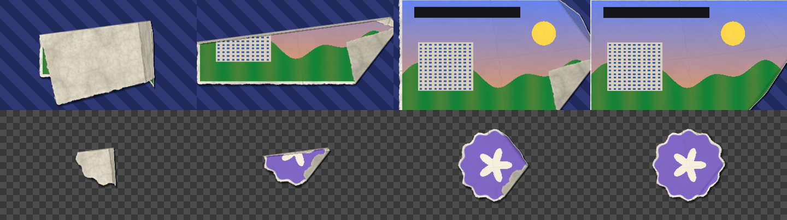

# MTTN PaperCraft Studio

> 🌐 **Español** | [English](README.en.md)

[](https://github.com/la-matatena/mttn-papercraft-studio/actions/workflows/ci-release.yml)
[](https://github.com/la-matatena/mttn-papercraft-studio/releases/latest)
[](LICENSE)
[](ofx/Info.plist)
[](docs/user_guide.md)
[](docs/developer_guide.md)
[](https://github.com/la-matatena)

**MTTN PaperCraft Studio** (desarrollado por **[La Matatena](https://la-matatena.com)** · [@la-matatena](https://github.com/la-matatena)) añade recortes de papel estilo stop-motion orgánico, bordes de cartulina rasgada, animaciones de entrada y salida de papel, una transición de papel que se dobla y se desdobla, y efectos de sonido de papel Foley en estéreo de 24 bits directamente sobre la página de Edición (Edit) de DaVinci Resolve 20 y 21 sin necesidad de abrir Fusion. Tanto DaVinci Resolve Free como DaVinci Resolve Studio ejecutan el plugin OpenFX 1.4 nativo en C++17 sin marcas de agua.



## Contenido del paquete

| Componente | Ruta del paquete | Propósito |
| :--- | :--- | :--- |
| Paquete OpenFX nativo | `PaperCraftStudioPro.ofx.bundle` | Efecto **Paper Cutout FX** y transición **Paper Fold & Unfold** en C++17 nativo para la página Edit (categoría `MTTN PaperCraft Studio`) |
| Instalador OpenFX para macOS | `Install_PaperCraft_OpenFX_macOS.command` | Compila el paquete Universal (`x86_64` + `arm64`) o nativo de macOS, firma ad-hoc e instala en `/Library/OFX/Plugins` |
| Desinstalador OpenFX para macOS | `Uninstall_PaperCraft_OpenFX_macOS.command` | Quita el plugin OpenFX (sistema o `--user`) y las plantillas `.drfx` de DaVinci Resolve |
| Instalador OpenFX para Linux | `install_linux_ofx.sh` | Instala `PaperCraftStudioPro.ofx.bundle` en la carpeta OpenFX de Linux |
| Código fuente OpenFX portátil | `OpenFX_Source/` | Código C++17 independiente y cabeceras de OpenFX 1.4 para compilación en macOS y Linux |
| Librería de sonidos Paper SFX | `Paper_SFX/` (4 archivos WAV estéreo) | Grabaciones reales de papel Foley a 48 kHz y 24 bits estéreo bajo dominio público (`CC0` / `Public Domain`) |
| Documentación y arquitectura | `docs/` (`user_guide.md`, `design_doc.md`, `developer_guide.md`) | Guía de usuario, guía de compilación para desarrolladores y arquitectura técnica detallada |
| Plantillas `.drfx` clásicas | `MTTN_PaperCraft_Studio.drfx` / `Templates_Unpacked/` | Plantillas Fusion `MacroOperator` validadas: el efecto **Paper Cutout FX** y la transición **Paper Fold & Unfold** (versión ligera de pliegue en tríptico), con miniaturas de identidad púrpura La Matatena |

## Documentación detallada

Consulta las guías completas para la instalación, flujos de trabajo en la página Edit y diseño de ingeniería:

- [Guía de usuario](docs/user_guide.md): Pasos de instalación, flujos de trabajo de Paper Cutout FX y Paper Fold & Unfold en la página Edit, explicación de parámetros del Inspector, tabla de mezcla para Paper SFX y resolución de problemas.
- [Documento de diseño de ingeniería](docs/design_doc.md): Visión general de la arquitectura, integración del host OpenFX 1.4, campo de distancia con signo (SDF) en tiempo lineal, librería de audio Foley real y decisiones de ingeniería.
- [Guía para desarrolladores y compilación](docs/developer_guide.md): Estructura del repositorio, compilación independiente en Linux y macOS y suites de verificación.

## Instalación del plugin nativo OpenFX para la página Edit

### Instalación en macOS

Se recomienda utilizar DaVinci Resolve descargado desde el sitio oficial de Blackmagic Design en lugar de la edición de la Mac App Store, ya que las restricciones de la sandbox de Apple impiden a la versión de la App Store cargar plugins OpenFX de terceros desde `/Library/OFX/Plugins`.

1. Descarga y extrae `MTTN_PaperCraft_Studio_Full_Bundle.zip` desde [GitHub Releases](https://github.com/la-matatena/mttn-papercraft-studio/releases/latest) (o clona este repositorio).
2. Haz doble clic en `Install_PaperCraft_OpenFX_macOS.command`, o ejecútalo desde **Terminal** dentro de la carpeta descomprimida (escribe `cd `, arrastra la carpeta a la ventana de Terminal y pulsa Intro). En el ZIP el script está directamente en la carpeta; en el repositorio clonado está dentro de `ofx/`:

   ```bash
   ./Install_PaperCraft_OpenFX_macOS.command        # ZIP de Releases
   ./ofx/Install_PaperCraft_OpenFX_macOS.command    # repositorio clonado
   ```

   Si prefieres una instalación a nivel de usuario sin requerir permisos de administrador (`sudo`), añade `--user` para instalar en `${HOME}/Library/OFX/Plugins`:

   ```bash
   ./Install_PaperCraft_OpenFX_macOS.command --user
   ```

3. Si `clang++` no está instalado aún, autoriza la descarga de las Command Line Tools de macOS y vuelve a ejecutar el instalador.
4. Reinicia DaVinci Resolve para que detecte el paquete OpenFX.

### Desinstalación en macOS

1. Cierra DaVinci Resolve.
2. Haz doble clic en `Uninstall_PaperCraft_OpenFX_macOS.command` (dentro de `ofx/` si clonaste el repositorio). El script quita el plugin OpenFX, tanto si lo instalaste para todo el sistema como con `--user`, y las plantillas `.drfx` opcionales. Si el plugin está en `/Library/OFX/Plugins`, te pedirá tu contraseña de administrador.

   Para ver qué se borraría sin borrar nada:

   ```bash
   ./Uninstall_PaperCraft_OpenFX_macOS.command --dry-run
   ```

3. Abre DaVinci Resolve: la categoría **MTTN PaperCraft Studio** ya no aparece. Los clips que usaban estos efectos los mostrarán como no disponibles; quítalos de tus líneas de tiempo.

### Instalación en Linux

1. Extrae `MTTN_PaperCraft_Studio_Full_Bundle.zip`.
2. Ejecuta el script instalador para Linux:

   ```bash
   ./install_linux_ofx.sh
   ```

   Añade `--user` para instalar en `${HOME}/.local/share/OFX/Plugins` sin permisos de root, o `--dest DIRECTORIO_PERSONALIZADO` para elegir otra ruta:

   ```bash
   ./install_linux_ofx.sh --dest DIRECTORIO_PERSONALIZADO
   ```

3. Reinicia DaVinci Resolve para cargar la suite OpenFX.

## Uso de MTTN PaperCraft Studio en la página Edit

El paquete OpenFX registra dos herramientas dentro de la categoría **MTTN PaperCraft Studio**:

- **Paper Cutout FX** (efecto): abre **Effects** > **Open FX** > **MTTN PaperCraft Studio** y arrástralo directamente sobre cualquier clip de la línea de tiempo, título, archivo PNG transparente o toma con pantalla verde.
- **Paper Fold & Unfold** (transición): abre **Effects** > **Open FX** > **Transitions** > **MTTN PaperCraft Studio** y arrástrala a un punto de edición, como cualquier transición.

### Desdoblar y doblar con Paper Fold & Unfold

La transición imita un papel impreso que se despliega en stop-motion: el clip llega como un paquete de papel doblado, se abre por etapas mostrando el reverso del papel, los pliegues y la sombra, y termina exactamente en el clip limpio. El modo **Auto** de **Fold Action** decide qué hacer según dónde la coloques:

| Dónde la colocas | Qué hace en modo Auto |
| :--- | :--- |
| Al inicio de un clip (sin nada antes) | El clip se **desdobla** y aparece |
| Al final de un clip (sin nada después) | El clip se **dobla** y sale del cuadro |
| Entre dos clips de imagen completa | El clip entrante se desdobla sobre el saliente |
| Entre dos clips con transparencia (PNG, títulos) | El saliente se dobla y después se desdobla el entrante |

Para forzar el comportamiento, elige **Unfold Incoming Clip**, **Fold Outgoing Clip** o **Fold Out, Then Unfold In**. En pistas superiores (`V2+`) la transparencia se conserva, así que un logotipo PNG puede desdoblarse sobre el vídeo de la pista inferior. La duración de la transición en la línea de tiempo marca la velocidad, y **Stop-Motion Steps** fija cuántas poses distintas se ven.

> [!NOTE]
> La versión 3.0 retiró el generador de Paper Cutout FX y las transiciones **Paper Unfold**, **Paper Crumple** y **Paper Rip Wipe**. Si un proyecto anterior las usaba, DaVinci Resolve las mostrará como no disponibles; quítalas de la línea de tiempo. La versión 3.1 añade **Paper Fold & Unfold** como transición nueva (con otro identificador), y el estilo **Paper Unfold (3D)** de Paper Cutout FX ahora dobla el recorte con pliegues reales.

## Referencia de controles del Inspector

### Paper Cutout FX

| Sección | Controles clave | Comportamiento |
| :--- | :--- | :--- |
| **1. Media Source and Placement** | **Source Mode**, **Premultiplied Source Alpha**, **Media Scale**, **Media Position**, **Media Rotation** | Alterna entre la entrada del clip de la línea de tiempo y la estampa integrada de La Matatena, permitiendo encuadrar la imagen dentro del recorte |
| **2. Green Screen and Matte Cleanup** | **Enable Green Screen Key**, **Screen Color**, **Key Gain**, **Key Balance**, **Edge Choke (px)** | Extrae la máscara del sujeto sobre fondos verdes o azules uniformes con supresión de contaminación de color |
| **3. Torn Paper Cutout Border** | **Enable Paper Border**, **Border Width**, **Torn Edge Roughness**, **Tear Frequency**, **Tear Fiber Detail**, **Edge Boil Speed**, **Paper Cardstock Color** | Genera un borde perimetral procedural de cartulina rasgada alrededor de la silueta alfa |
| **4. Paper Grain and Fold Creases** | **Paper Grain Strength**, **Grain Scale**, **Fold Crease Strength**, **Crease Scale**, **Media Texture Overlay**, **Texture Seed** | Añade textura de fibra de papel multicapa y pliegues marcados de doblado |
| **5. Intro and Outro Paper Animations** | **Intro Style**, **Intro Duration (Frames)**, **Outro Style**, **Outro Duration (Frames)**, **Glide Angle**, **Glide Distance**, **Mirror Animation H**, **Mirror Animation V** | Anima entradas y salidas con estilos **Paper Unfold (3D)** (pliegues reales con reverso de papel; **Glide Angle** también gira la dirección del pliegue), **Crumple Ball**, **Paper Airplane Glide** o **Flat Cutout Pop** |
| **6. 3D Drop Shadow** | **Shadow Opacity**, **Shadow Angle**, **Shadow Distance**, **Shadow Softness** | Proyecta una sombra suave y direccional con profundidad detrás del recorte en rotación |
| **7. Stop-Motion and Master Transform** | **Enable Stop-Motion**, **Hold Frames (Step)**, **Position Jitter**, **Rotation Jitter**, **Master Position**, **Master Scale**, **Master Rotation**, **Flip Horizontal**, **Flip Vertical** | Cuantiza el movimiento en fotogramas sostenidos y añade una vibración táctil fotograma a fotograma |

### Paper Fold & Unfold

| Sección | Controles clave | Comportamiento |
| :--- | :--- | :--- |
| **1. Fold & Unfold** | **Fold Action**, **Fold Pattern**, **Fold Stages**, **Fold Direction**, **3D Depth**, **Packet Slide Distance**, **Mirror Horizontal**, **Mirror Vertical** | Elige si el clip se desdobla, se dobla o ambas cosas; el patrón de pliegues (**Craft Flaps**, **Map Grid**, **Accordion**, **Origami Corners**), cuántas etapas se abren (2 a 5), su orientación, la perspectiva de las solapas y cuánto se desliza el paquete doblado al entrar o salir |
| **2. Paper Look** | **Torn Paper Border**, **Border Width**, **Torn Edge Roughness**, **Tear Frequency**, **Paper Color**, **Paper Grain**, **Crease Strength**, **Paper Seed**, **Premultiplied Source Alpha** | Borde de cartulina rasgada opcional mientras el papel está doblado, color y textura del reverso, arrugas y marcas de pliegue; el borde y las marcas se desvanecen al terminar para que el último fotograma sea el clip limpio |
| **3. Stop-Motion & Shadow** | **Enable Stop-Motion**, **Stop-Motion Steps**, **Hand Jitter**, **Shadow Opacity**, **Shadow Angle**, **Shadow Distance**, **Shadow Softness** | Poses sostenidas con vibración de mano, sombra proyectada del paquete y sombras de las solapas; el ángulo de sombra también ilumina las solapas |

## Librería de sonidos Paper SFX

Importa la carpeta `Paper_SFX/` dentro de un Power Bin de DaVinci Resolve para reutilizar en todos tus proyectos las 4 grabaciones reales de papel Foley a 48 kHz y 24 bits estéreo (consulta autores y licencias en [`Paper_SFX/CREDITS.md`](Paper_SFX/CREDITS.md)):

- `01_Paper_Unfold.wav`: Despliegue de pliego de papel doblado para la transición **Paper Fold & Unfold** y las entradas y salidas **Paper Unfold (3D)**.
- `02_Paper_Crumple.wav`: Arrugado orgánico de hoja en bola para **Crumple Ball**.
- `03_Paper_Glide_Flip.wav`: Barrido y giro rápido de hoja para **Paper Airplane Glide** y cambios de página.
- `04_Paper_Rip_Tear.wav`: Rasgado seco de fibra para bordes de cartulina rasgada y **Flat Cutout Pop**.

## Plantillas clásicas `.drfx` opcionales

El archivo validado `MTTN_PaperCraft_Studio.drfx` se incluye para quienes prefieren trabajar con plantillas de Fusion. Haz doble clic en `MTTN_PaperCraft_Studio.drfx` para instalar la copia `MacroOperator` de **Paper Cutout FX** en **Effects** > **Toolbox** > **MTTN PaperCraft Studio** y la transición **Paper Fold & Unfold** en **Effects** > **Toolbox** > **Video Transitions** > **MTTN PaperCraft Studio**. La transición de Fusion es una versión ligera: un pliegue en tríptico (tres paneles) con reverso de papel, arrugas, paquete deslizante, stop-motion y sombra, sin borde rasgado ni patrones de pliegue. Para líneas de tiempo cotidianas se recomienda el plugin OpenFX nativo, ya que se ejecuta en C++17 multihilo sin la sobrecarga del grafo de nodos de Fusion.

## Optimizar la fluidez de reproducción y renderizado

- Cambia **Playback** > **Render Cache** a **Smart** o **User** una vez que hayas ajustado los parámetros del recorte o de la transición.
- Reduce temporalmente **Playback** > **Timeline Proxy Resolution** a **Half** o **Quarter** al ajustar los tiempos de las animaciones stop-motion.
- **Paper Fold & Unfold** tarda de media unos 28 ms por fotograma 1080p con 4 hilos de un Mac con Apple M4 Pro (unos 14 ms con 14 hilos). En equipos más modestos, como un iMac 2017, usa **Render Cache** para reproducir la transición en tiempo real.

## Compilación y verificación desde el código fuente

Ejecuta la suite de pruebas en Python para validar el `.drfx`, miniaturas PNG, archivos de audio Foley WAV y el empaquetado general:

```bash
python3 -B papercraft_pro_test.py -v
```

Compila el paquete OpenFX Universal para macOS en un directorio temporal sin modificar `/Library/OFX/Plugins`:

```bash
./ofx/Install_PaperCraft_OpenFX_macOS.command --build-only ./dist
```

Construye el paquete completo de lanzamiento (`.drfx`, 4 WAVs de Foley real, instaladores, documentación y código fuente):

```bash
python3 -B build_papercraft_bundle.py \
  --output_dir=dist \
  --readme_path=README.md \
  --linux_ofx_path=PaperCraftStudioPro.ofx
```

## Licencia

Publicado bajo la [Licencia MIT](LICENSE) — Copyright (c) 2026 [La Matatena](https://la-matatena.com). Las cabeceras C de OpenFX 1.4 incluidas mantienen su licencia permisiva en [`ofx/openfx_include/LICENSE`](ofx/openfx_include/LICENSE), y las grabaciones Foley de `Paper_SFX/` están en dominio público (`CC0 1.0` / `Public Domain`) según se detalla en [`Paper_SFX/CREDITS.md`](Paper_SFX/CREDITS.md).
