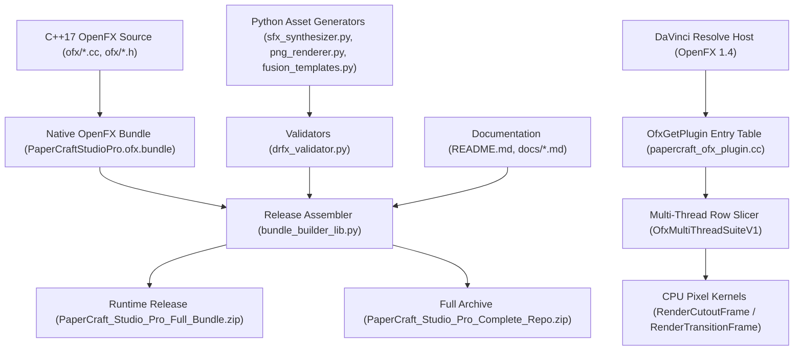
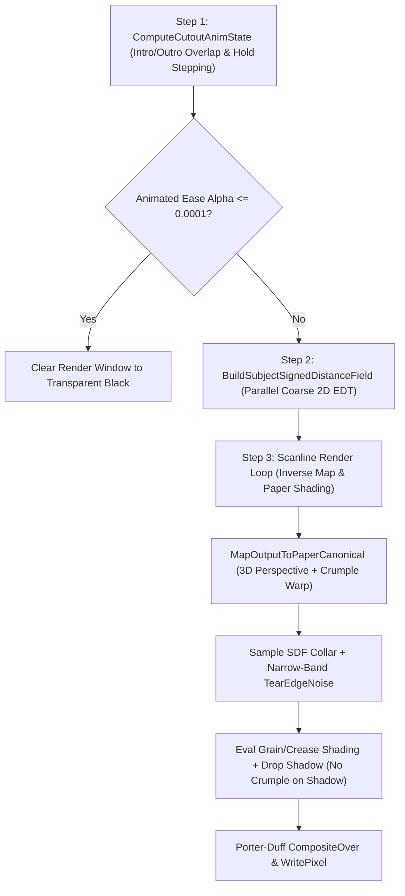

# PaperCraft Studio Pro design document

This design document explains the architecture, OpenFX 1.4 C++17 rendering
pipeline, procedural Foley audio synthesis, legacy Fusion packaging, and
engineering trade-offs if you maintain, audit, or extend PaperCraft Studio Pro.

## Context and goals

Video editors on the DaVinci Resolve 20 and 21 Edit pages often rely on complex
Fusion node graphs to create stop-motion paper cutouts, torn cardstock rims, and
3D folded paper transitions. Distributing effects solely as `.drfx` Fusion
`MacroOperator` templates forces DaVinci Resolve to spin out background Fusion
render passes that increase timeline caching latency, risk opaque matte clipping
on `V2` or higher overlay tracks, and break when host updates change node
defaults.

PaperCraft Studio Pro solves this bottleneck by compiling the primary toolkit as
a self-contained C++17 OpenFX 1.4 bundle (`PaperCraftStudioPro.ofx.bundle`) that
runs directly inside the Edit page OpenFX host while shipping deterministic
Python builders for 48 kHz, 24-bit stereo Paper SFX WAV files and validated
legacy `.drfx` templates.

### Goals

-   **Direct Edit-page execution**: Register effect, generator, and transition
    plugins directly under **PaperCraft Studio** in the Edit page **Effects**
    panel without opening Fusion.
-   **Compatibility across Free and Studio editions**: Use standard CPU OpenFX
    1.4 APIs so DaVinci Resolve Free and DaVinci Resolve Studio run every effect
    without watermarks on Linux x86-64 and macOS (`arm64` and `x86_64`).
-   **Upper-track alpha fidelity**: Preserve straight, premultiplied, and opaque
    input alpha channels across effects and transitions so upper-track (`V2` and
    higher) overlays keep lower tracks visible.
-   **Hermetic, deterministic packaging**: Synthesize all stereo Foley WAV
    files, thumbnails, demo assets, validated `.drfx` bundles, and source
    archives from Python and C++ source without network access or checked-in
    binary blobs.

### Non-goals

-   **Proprietary GPU shader lock-in**: The OpenFX renderer does not require
    CUDA, Metal, OpenCL, or Studio-only DCTL scripts.
-   **Runtime external network calls**: Neither the build toolchain nor the
    runtime OpenFX bundle fetches remote assets or licenses.
-   **Intel macOS support in DaVinci Resolve 21**: Blackmagic Design dropped
    Intel Mac hardware in DaVinci Resolve 21, so Apple Silicon (`arm64`) is the
    macOS target for Resolve 21 while the macOS installer continues building
    Universal binaries when `clang++` supports both architectures for
    Resolve 20.

## System architecture

PaperCraft Studio Pro separates into a C++17 runtime plugin core under the
`ofx/` directory and a deterministic Python asset-synthesis and packaging layer
at the repository root.

### Module responsibilities

| Component path                                | Language | Responsibility       |
| :-------------------------------------------- | :------- | :------------------- |
| `ofx/papercraft_kernel.h`                     | C++17    | Declares buffer      |
:                                               :          : views, alpha modes,  :
:                                               :          : parameter structs,   :
:                                               :          : and render entry     :
:                                               :          : points               :
| `ofx/papercraft_kernel.cc`                    | C++17    | Implements keying,   |
:                                               :          : signed distance      :
:                                               :          : field transform,     :
:                                               :          : inverse perspective, :
:                                               :          : tear noise, and      :
:                                               :          : compositing          :
| `ofx/papercraft_ofx_plugin.cc`                | C++17    | Implements OpenFX    |
:                                               :          : 1.4 plugin table,    :
:                                               :          : parameter            :
:                                               :          : definitions, suite   :
:                                               :          : bindings, and thread :
:                                               :          : dispatch             :
| `ofx/papercraft_ofx_test.cc`                  | C++17    | Exercises compiled   |
:                                               :          : Linux `.ofx` by      :
:                                               :          : using mock OpenFX    :
:                                               :          : 1.4 host suites and  :
:                                               :          : GUnit assertions     :
| `ofx/Info.plist` and `ofx/openfx_sym.lds`     | XML /    | Defines macOS bundle |
:                                               : linker   : metadata and         :
:                                               :          : restricts Linux      :
:                                               :          : dynamic symbol       :
:                                               :          : exports              :
| `ofx/openfx_include/`                         | C        | Vendored OpenFX 1.4  |
:                                               :          : headers and license  :
:                                               :          : for hermetic and     :
:                                               :          : standalone builds    :
| `ofx/Install_PaperCraft_OpenFX_macOS.command` | Bash     | Compiles standalone  |
:                                               :          : macOS bundle         :
:                                               :          : (`x86_64` and        :
:                                               :          : `arm64`) and         :
:                                               :          : installs it          :
| `ofx/install_linux_ofx.sh`                    | Bash     | Installs the         |
:                                               :          : prebuilt Linux       :
:                                               :          : x86-64 bundle to     :
:                                               :          : system or user       :
:                                               :          : OpenFX folders       :
| `sfx_synthesizer.py`                          | Python   | Synthesizes 24       |
:                                               :          : stereo 48 kHz 24-bit :
:                                               :          : PCM Paper SFX WAV    :
:                                               :          : files using biquad   :
:                                               :          : modal filters        :
| `png_renderer.py`                             | Python   | Generates `104x58`   |
:                                               :          : Effect Library       :
:                                               :          : thumbnails and a     :
:                                               :          : `512x512` procedural :
:                                               :          : sticker PNG          :
| `fusion_templates.py`                         | Python   | Builds repaired      |
:                                               :          : legacy `.setting`    :
:                                               :          : Fusion               :
:                                               :          : `MacroOperator`      :
:                                               :          : graphs for `.drfx`   :
:                                               :          : export               :
| `drfx_validator.py`                           | Python   | Validates `.setting` |
:                                               :          : delimiter balance,   :
:                                               :          : control counts,      :
:                                               :          : expressions, PNG     :
:                                               :          : dimensions, and WAV  :
:                                               :          : bounds               :
| `bundle_builder_lib.py` and                   | Python   | Assembles            |
: `build_papercraft_bundle.py`                  :          : deterministic        :
:                                               :          : release folders,     :
:                                               :          : `.drfx`, full        :
:                                               :          : runtime ZIP, and     :
:                                               :          : complete repository  :
:                                               :          : ZIP                  :
| `papercraft_pro_test.py`                      | Python   | Tests                |
:                                               :          : audio/image/template :
:                                               :          : validation,          :
:                                               :          : installer dry runs,  :
:                                               :          : archive permissions, :
:                                               :          : and doc links        :
| `BUILD`                                       | Starlark | Defines Blaze        |
:                                               :          : targets for C++,     :
:                                               :          : Python, standalone   :
:                                               :          : compile checks,      :
:                                               :          : tests, and genrule   :
:                                               :          : packaging            :

## OpenFX 1.4 host integration

The compiled shared object exports only the two entry functions required by the
OpenFX 1.4 specification: `OfxGetNumberOfPlugins` and `OfxGetPlugin`. On Linux,
the `ofx/openfx_sym.lds` version script hides all internal symbols so C++
symbols cannot collide with DaVinci Resolve libraries. On macOS, the installer
script passes the `-Wl,-exported_symbol` linker flag for both symbols alongside
`-fvisibility=hidden`.

### Registered plugin roles

A single templated wrapper (`RoleCallbacks<PluginRole>`) routes host callbacks
for four distinct OpenFX descriptors inside the **PaperCraft Studio** group:

| OpenFX identifier                  | Supported contexts | Display label    |
| :--------------------------------- | :----------------- | :--------------- |
| `com.papercraft.CutoutFX`          | Filter and         | **Paper Cutout   |
:                                    : Generator          : FX**             :
| `com.papercraft.UnfoldTransition`  | Transition         | **Paper Unfold   |
:                                    :                    : Transition**     :
| `com.papercraft.CrumpleTransition` | Transition         | **Paper Crumple  |
:                                    :                    : Transition**     :
| `com.papercraft.RipWipeTransition` | Transition         | **Paper Rip Wipe |
:                                    :                    : Transition**     :

In Transition context, the `DefineTransitionParameters` function registers the
mandatory OpenFX `Transition` parameter (`kOfxImageEffectTransitionParamName`),
letting the DaVinci Resolve timeline engine drive normalized `0.0` to `1.0`
progress between the `SourceFrom` clip and the `SourceTo` clip.

### Pixel depths, alpha modes, and region mapping

All plugins accept `OfxBitDepthFloat` (32-bit float), `OfxBitDepthShort` (16-bit
unsigned integer), and `OfxBitDepthByte` (8-bit unsigned integer) RGBA buffers.
The `HandleGetClipPreferences` action reads unmapped source bit depth from the
host and propagates it so 8-bit timelines do not force unnecessary format
conversions.

During image extraction, the `ExtractImageView` function reads both
`kOfxImagePropBounds` (physical allocated buffer extent) and
`kOfxImagePropRegionOfDefinition` (canonical frame extent) into the `ImageView`
struct alongside signed `row_bytes` for hosts that store inverted scanlines.
When reading pixels, the `ReadPixel` function inspects `AlphaMode`:

-   `AlphaMode::kOpaque`: forces alpha to `1.0` so RGB footage with zeroed
    fourth bytes renders visibly.
-   `AlphaMode::kUnPremultiplied`: premultiplies RGB channels by clamped alpha
    before bilinear filtering in `SampleBilinearClamped` to prevent color
    fringes around straight-alpha titles and PNG stickers.
-   `AlphaMode::kPremultiplied`: reads premultiplied linear values directly.

During sampling, the `EffectiveRod` helper maps normalized frame coordinates
across the clip region of definition (`rod`), while
`SampleBilinearTransparentOutside` clips reads outside physical `bounds` cleanly
to transparent black.

### Threading and tiling strategy

All plugins advertise `kOfxImageEffectRenderFullySafe` and set
`kOfxImageEffectPluginPropHostFrameThreading` to `1`. Inside `HandleRender`, the
`DispatchParallelRows` adapter delegates scanline ranges `[y_start, y_end)` to
the host `OfxMultiThreadSuiteV1` pool (`multiThread`), falling back to
sequential execution if the host omits the threading suite or runs with a single
worker.

The `HandleDescribe` action explicitly sets `kOfxImageEffectPropSupportsTiles`
to `0` on `CutoutFX` (and disables tiling on clip descriptors across all
plugins). Because torn paper collars can expand up to 15% of frame width around
off-edge subjects and fold transitions shift geometry across the whole canvas,
requiring full-frame buffers eliminates visible rectangular tile seam artifacts
while still honoring host `renderWindow` bounds during rendering.

## Procedural paper rendering pipeline

Each rendered frame of **Paper Cutout FX** flows sequentially from timing
quantization and distance field computation to inverse-mapped paper synthesis
and shadow compositing inside the `RenderCutoutFrame` function.

### Chroma key extraction and subject framing

If `source_mode` selects the built-in paper sticker or the plugin runs as a
Generator, the `EvaluateSubjectAtCanonicalPx` function procedurally draws an
anti-aliased layered craft badge. Otherwise, it transforms canonical output
coordinates inversely using frame-constant subject scale, rotation, and offset
values in `SubjectTransform` and samples the source image through the
`EffectiveRod` mapping. When chroma keying is active, the `ApplyChromaKey`
function computes a color-difference matte against `key_color`, suppresses green
or blue color spill on the keyed pixels, and scales edge opacity smoothly.

### Linear-time 2D Euclidean signed distance field

To generate an organic torn cardstock collar around arbitrary keyed shapes,
`BuildSubjectSignedDistanceField` constructs a signed Euclidean distance field
on a dynamically scaled coarse grid bounded by `kMaxSdfDim = 960` columns (and a
minimum `540`-row target stride before clamping). After evaluating the subject
matte in parallel across coarse rows, `DistanceTransform2D` executes the
Felzenszwalb-Huttenlocher parabolic lower-envelope distance transform across
columns and rows in parallel (`O(W * H)` linear time with zero heap allocations
inside worker loops thanks to stack-allocated `std::array` scratch arrays):

$$D(p) = \min_{q} \left( (p - q)^2 + f(q) \right)$$

Subtracting the inner distance field from the outer distance field and
multiplying by the grid stride produces sub-pixel bilinear distance estimates in
canonical canvas pixels through `CoarseSignedDistanceField::SamplePx`. Positive
or negative `edge_choke_px` offsets shift the effective matte boundary prior to
border width evaluation.

### Inverse 3D perspective and crumple displacement

For each pixel inside `render_window`, `MapOutputToPaperCanonical` applies the
inverse global cutout transform, inverse flip axes, inverse 2D glide offset,
inverse pop scale, and an inverse 3D hinge perspective divide across both
horizontal and vertical mirror directions. When an unfold or crumple transition
is active (`crumple_warp_norm > 0.0001`), the `CrumpleDisplacement` helper adds
a faceted ridged Voronoi-style crease offset and extracts facet lighting terms.

To reduce per-pixel ALU cost on 4K timelines, `RenderCutoutFrame` invokes
`MapOutputToPaperCanonical` with `apply_crumple = false` when looking up the
offset drop shadow pixel (`px_out - sh_dx_px`, `py_out - sh_dy_px`), avoiding a
redundant multi-octave Voronoi evaluation behind the soft Gaussian-like shadow
skirt.

### Narrow-band torn edge noise and paper textures

The `TearEdgeNoise` function evaluates multi-octave periodic value noise around
the subject perimeter. Because border roughness (`tear_amp_px`) influences alpha
only close to the nominal cardstock rim
(`base_edge_dist = dist_px - border_px`), the renderer skips `TearEdgeNoise`
completely whenever `abs(base_edge_dist)` exceeds `tear_amp_px + 3.1f`.
Cardstock fiber grain and fold crease shading are subsequently combined with
foreground ink (`media_texture_overlay`) and composited over the drop shadow
using `CompositeOver`.

### Short-clip timing and stop-motion stepping

When clips are shorter than `introFrames + outroFrames`, additive intro and
outro progress weights would overlap and jump abruptly at the end of the intro
window. The `ComputeCutoutAnimState` function measures distance from both the
clip in-point (`t_in`) and out-point (`t_out`) independently and selects
`min(t_in, t_out)` so entrance and exit motion hand off smoothly across the clip
midpoint. Enabling stop-motion stepping quantizes timeline progress to
`holdFrames` buckets and derives deterministic pseudo-random per-step XY jitter,
rotational wobble, and border tear boiling.

### Upper-track transition compositing

The `RenderTransitionFrame` function drives three transitions (`kUnfold`,
`kCrumple`, and `kRipWipe`):

-   **Paper Unfold Transition** and **Paper Crumple Transition**: Apply
    perspective hinge fold or faceted ball crumple geometry onto the active
    outgoing or incoming sheet (`fg`) while preserving `fg.a`
    (`out_fg_a = Clamp01(fg.a) * sheet_alpha`), rendering premultiplied cast
    shadows (`shadow_a`) weighted by foreground sheet alpha instead of painting
    an opaque background plate.
-   **Paper Rip Wipe Transition**: Restricts multi-octave `TearEdgeNoise` and
    dual-clip sampling to the narrow torn paper strip around the wipe plane,
    multiplying background shadow cleanly by `1 - outer_mask` so transparent
    foreground clips on Video Track 2 or higher never leak ghosts of the
    outgoing clip.

## Physical-modeling Foley audio synthesis

The `sfx_synthesizer.py` module generates 24 stereo 48 kHz, 24-bit PCM WAV files
across six folders without relying on pre-recorded samples:

1.  **Modal cardstock bodies**: Excitations pass through parallel RBJ
    direct-form-II transposed bandpass filters (`_modal_paper_body`) tuned to
    `light_modes`, `heavy_modes`, or `news_modes` spectral peaks (covering 420
    Hz to 5200 Hz).
2.  **Paper buckling impulses**: `_generate_buckling_impulses` produces
    power-law distributed transient snaps characteristic of folding and
    crumpling sheets.
3.  **Mechanical gestures**: `_synth_page_turn`, `_synth_paper_hit`,
    `_synth_crumple`, `_synth_rip`, `_synth_rustle_or_bits`, and
    `_synth_designed_transition` shape temporal envelopes, table-thud
    fundamental sine bursts, and air-whoosh bands.
4.  **Stereo widening and normalization**: `_stereo_decorrelate` adds
    millisecond Haas inter-channel delays and optional stereo pan sweeps before
    peak-limiting below full scale (`0.995`) and applying smooth zero-crossing
    cosine fades in `encode_wav_24bit_stereo`.

## Legacy Fusion template generation and static validation

For existing `.drfx` workflows, `fusion_templates.py` builds five Fusion
`.setting` scripts packaged with `png_renderer.py` icons (`104x58` pixels) and a
`512x512` sticker PNG. To avoid Edit-page black frames and frozen lengths
observed in third-party Fusion macros, all generated templates follow strict
structural invariants verified statically by `drfx_validator.py`:

-   Top-level nodes declare `MacroOperator` paired with
    `ViewInfo = OperatorInfo` instead of `GroupOperator` or `GroupInfo`.
-   Generator templates set `GlobalOut = Input { Value = 1000000 }` and
    `GlobalEnd = 1000000` so you can drag generators freely to any timeline
    duration.
-   Every `LBLC_DropDownButton` group count matches the exact number of nested
    child controls declared in `LBLC_NumInputs`.
-   Every `SimpleExpression` omits Lua `math.` prefixes and C-style `&&` or `||`
    operators, and every macro control reference exists in `UserControls`.

## Design decisions and trade-offs

| Decision     | Chosen option                             | Alternative | Why chosen     |
: area         :                                           : considered  :                :
| :----------- | :---------------------------------------- | :---------- | :------------- |
| Primary      | Native C++17 OpenFX 1.4 CPU plugin        | Fusion      | Direct         |
: Edit-page    :                                           : `.drfx`     : Edit-page      :
: effect       :                                           : macros only : execution      :
: architecture :                                           :             : without Fusion :
:              :                                           :             : overhead,      :
:              :                                           :             : watermark-free :
:              :                                           :             : on Free and    :
:              :                                           :             : Studio,        :
:              :                                           :             : upper-track    :
:              :                                           :             : alpha support  :
| Compute API  | Pure C++17 CPU with                       | DCTL /      | Runs           |
:              : `OfxMultiThreadSuiteV1`                   : OpenCL /    : identically on :
:              :                                           : Metal       : Free and       :
:              :                                           : shaders     : Studio         :
:              :                                           :             : editions       :
:              :                                           :             : across macOS   :
:              :                                           :             : Apple Silicon, :
:              :                                           :             : macOS Intel,   :
:              :                                           :             : and Linux      :
:              :                                           :             : without GPU    :
:              :                                           :             : driver         :
:              :                                           :             : differences    :
| OpenFX       | `SupportsTiles = 0` on `CutoutFX` with    | Per-tile    | Torn paper     |
: tiling       : `renderWindow` support                    : OpenFX      : borders        :
: policy       :                                           : buffer      : require global :
:              :                                           : processing  : signed         :
:              :                                           :             : distance       :
:              :                                           :             : fields across  :
:              :                                           :             : full-frame     :
:              :                                           :             : subject        :
:              :                                           :             : silhouettes to :
:              :                                           :             : avoid tile     :
:              :                                           :             : boundary seams :
| macOS binary | Source-compiled Universal bundle built    | Checking    | Keeps source   |
: delivery     : with                                      : Mach-O      : control        :
: from Linux   : `Install_PaperCraft_OpenFX_macOS.command` : binaries or : binary-free,   :
:              : plus Blaze                                : third-party :                :

\: build : `:papercraft_standalone_compile_check` : cross-compilers :
supports : : environment : : into source : `arm64` and : : : : control :
`x86_64` with : : : : : local Xcode : : : : : Command Line : : : : : Tools,
and : : : : : keeps : : : : : `#include` : : : : : parity checked : : : : : in
CI : | Paper SFX | Deterministic Python synthesis in | Committing 24 |
Guarantees | : library : `sfx_synthesizer.py` at build time : multi-megabyte :
reproducible : : storage : : `.wav` binaries : 48 kHz, 24-bit : : : : into
Piper : WAV output : : : : : verified by : : : : : automated RMS, : : : : :
clipping, and : : : : : stereo checks :

## Verification architecture

Two automated test suites validate the runtime plugin and asset packager inside
Blaze:

1.  **C++ OpenFX 1.4 host compliance and kernel suite
    (`ofx/papercraft_ofx_test.cc`)**: Dynamically loads (`dlopen`) the compiled
    `PaperCraftStudioPro.ofx` shared library, verifies symbol exports
    (`OfxGetNumberOfPlugins` and `OfxGetPlugin`), emulates full OpenFX 1.4
    property/parameter/image/multi-thread host suites, and asserts pixel
    correctness across float/short/byte depths, negative `row_bytes` scanlines,
    cropped `bounds` against `rod`, `kOfxImageOpaque` and
    `kOfxImageUnPreMultiplied` alpha modes, `V2` overlay transparency, `mirrorV`
    and `mirrorTransV` toggles, and overlapping short-clip intro/outro timing.
2.  **Python packager and asset suite (`papercraft_pro_test.py`)**: Validates
    all 24 synthesized WAVs, checks `.setting` graphs and negative mutation
    failures in `drfx_validator.py`, tests Bash syntax and `--dry-run` behavior
    of both OS installers, verifies nested-directory installation with
    `install_linux_ofx.sh`, confirms ZIP entry permissions (`0o755` for
    executables and `.ofx`), and audits relative Markdown links across
    `README.md` and `docs/*.md`.

## What's next

-   Read the [user guide](user_guide.md) for installation instructions,
    Edit-page workflows, Inspector parameters, and Paper SFX mixing guidance.
-   Read the [developer and build guide](developer_guide.md) to compile
    standalone OpenFX bundles or add custom visual parameters and Foley audio
    presets.
