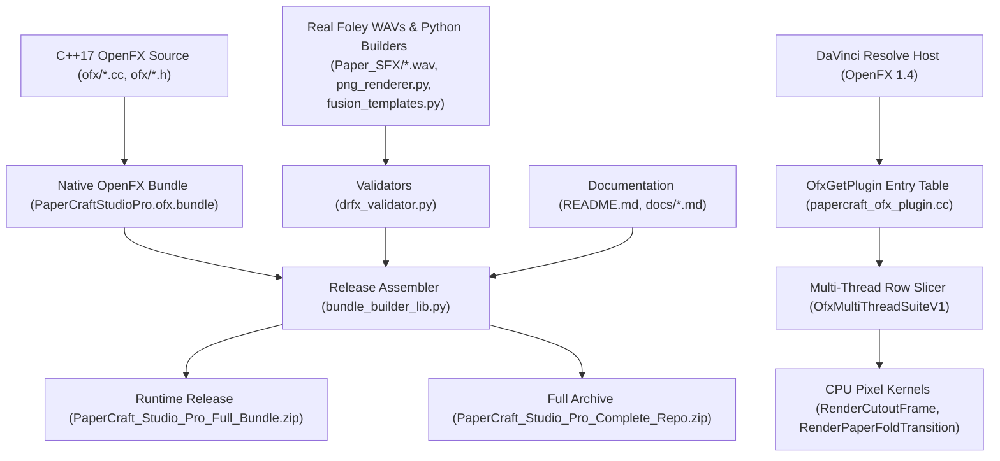
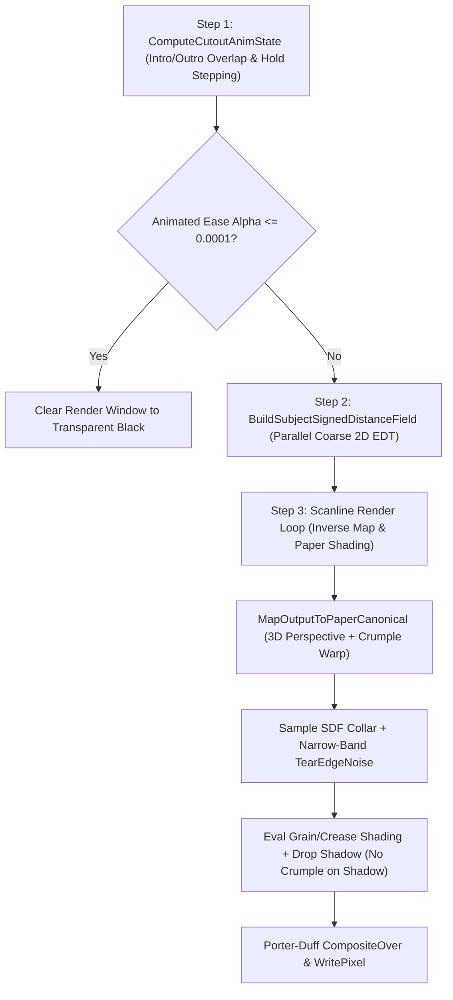
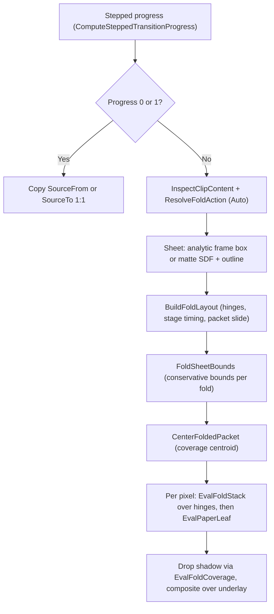

# PaperCraft Studio Pro design document

This design document explains the architecture, OpenFX 1.4 C++17 rendering
pipeline, curated real-world Foley audio packaging, legacy Fusion packaging, and
engineering trade-offs if you maintain, audit, or extend PaperCraft Studio Pro.

## Context and goals

Video editors on the DaVinci Resolve 20 and 21 Edit pages often rely on complex
Fusion node graphs to create stop-motion paper cutouts, torn cardstock rims, and
3D folded paper intro and outro animations. Distributing effects solely as
`.drfx` Fusion `MacroOperator` templates forces DaVinci Resolve to spin out
background Fusion render passes that increase timeline caching latency, risk
opaque matte clipping on `V2` or higher overlay tracks, and break when host
updates change node defaults.

PaperCraft Studio Pro 3.1.0 solves this bottleneck by compiling the **Paper
Cutout FX** filter and the **Paper Fold & Unfold** transition into a
self-contained C++17 OpenFX 1.4 bundle (`PaperCraftStudioPro.ofx.bundle`) that
runs directly inside the Edit page OpenFX host while bundling four real-world
48 kHz, 24-bit stereo Paper SFX WAV recordings and validated legacy `.drfx`
templates.

### Goals

-   **Direct Edit-page execution**: Register a filter under **Open FX** >
    **MTTN PaperCraft Studio** and a transition under **Open FX** >
    **Transitions** > **MTTN PaperCraft Studio** in the Edit page **Effects**
    panel without opening Fusion.
-   **Compatibility across Free and Studio editions**: Use standard CPU OpenFX
    1.4 APIs so DaVinci Resolve Free and DaVinci Resolve Studio run the effect
    without watermarks on Linux x86-64 and macOS (`arm64` and `x86_64`).
-   **Upper-track alpha fidelity**: Preserve straight, premultiplied, and opaque
    input alpha channels so upper-track (`V2` and higher) overlays keep lower
    tracks visible.
-   **Hermetic, deterministic packaging**: Validate and package the four stereo
    Foley WAV recordings, thumbnails, `.drfx` bundles, and source archives
    deterministically without network access at build time.

### Non-goals

-   **Proprietary GPU shader lock-in**: The OpenFX renderer does not require
    CUDA, Metal, OpenCL, or Studio-only DCTL scripts.
-   **Runtime external network calls**: Neither the build toolchain nor the
    runtime OpenFX bundle fetches remote assets or licenses.
-   **Intel macOS support in DaVinci Resolve 21**: Blackmagic Design dropped
    Intel Mac hardware in DaVinci Resolve 21, so Apple Silicon (`arm64`) is the
    macOS target for Resolve 21 while the macOS installer continues building
    Universal binaries when `clang++` supports both architectures for
    Resolve 20.

## System architecture

PaperCraft Studio Pro separates into a C++17 runtime plugin core under the
`ofx/` directory and a deterministic Python asset-synthesis and packaging layer
at the repository root.

### Module responsibilities

| Component path                                | Language | Responsibility       |
| :-------------------------------------------- | :------- | :------------------- |
| `ofx/papercraft_kernel.h`                     | C++17    | Declares buffer      |
:                                               :          : views, alpha modes,  :
:                                               :          : parameter structs,   :
:                                               :          : and render entry     :
:                                               :          : points               :
| `ofx/papercraft_kernel.cc`                    | C++17    | Implements keying,   |
:                                               :          : signed distance      :
:                                               :          : field transform,     :
:                                               :          : inverse perspective, :
:                                               :          : tear noise, and      :
:                                               :          : compositing          :
| `ofx/papercraft_ofx_plugin.cc`                | C++17    | Implements OpenFX    |
:                                               :          : 1.4 plugin table,    :
:                                               :          : parameter            :
:                                               :          : definitions, suite   :
:                                               :          : bindings, and thread :
:                                               :          : dispatch             :
| `ofx/papercraft_ofx_test.cc`                  | C++17    | Exercises compiled   |
:                                               :          : Linux `.ofx` by      :
:                                               :          : using mock OpenFX    :
:                                               :          : 1.4 host suites and  :
:                                               :          : GUnit assertions     :
| `ofx/Info.plist` and `ofx/openfx_sym.lds`     | XML /    | Defines macOS bundle |
:                                               : linker   : metadata and         :
:                                               :          : restricts Linux      :
:                                               :          : dynamic symbol       :
:                                               :          : exports              :
| `ofx/openfx_include/`                         | C        | Vendored OpenFX 1.4  |
:                                               :          : headers and license  :
:                                               :          : for hermetic and     :
:                                               :          : standalone builds    :
| `ofx/Install_PaperCraft_OpenFX_macOS.command` | Bash     | Compiles standalone  |
:                                               :          : macOS bundle         :
:                                               :          : (`x86_64` and        :
:                                               :          : `arm64`) and         :
:                                               :          : installs it          :
| `ofx/install_linux_ofx.sh`                    | Bash     | Installs the         |
:                                               :          : prebuilt Linux       :
:                                               :          : x86-64 bundle to     :
:                                               :          : system or user       :
:                                               :          : OpenFX folders       :
| `Paper_SFX/`                                  | WAV /    | Stores four real     |
:                                               : Markdown : 48 kHz, 24-bit       :
:                                               :          : stereo Foley WAV     :
:                                               :          : recordings and       :
:                                               :          : public-domain        :
:                                               :          : credits              :
| `png_renderer.py`                             | Python   | Generates the        |
:                                               :          : `104x58` Effect      :
:                                               :          : Library thumbnail    :
| `fusion_templates.py`                         | Python   | Builds the legacy    |
:                                               :          : **Paper Cutout FX**  :
:                                               :          : `.setting` Fusion    :
:                                               :          : `MacroOperator`      :
:                                               :          : graph for `.drfx`    :
:                                               :          : export               :
| `drfx_validator.py`                           | Python   | Validates `.setting` |
:                                               :          : delimiter balance,   :
:                                               :          : control counts,      :
:                                               :          : expressions, PNG     :
:                                               :          : dimensions, and WAV  :
:                                               :          : bounds               :
| `bundle_builder_lib.py` and                   | Python   | Assembles            |
: `build_papercraft_bundle.py`                  :          : deterministic        :
:                                               :          : release folders,     :
:                                               :          : `.drfx`, full        :
:                                               :          : runtime ZIP, and     :
:                                               :          : complete repository  :
:                                               :          : ZIP                  :
| `papercraft_pro_test.py`                      | Python   | Tests                |
:                                               :          : audio/image/template :
:                                               :          : validation,          :
:                                               :          : installer dry runs,  :
:                                               :          : archive permissions, :
:                                               :          : and doc links        :
| `BUILD`                                       | Starlark | Defines Blaze        |
:                                               :          : targets for C++,     :
:                                               :          : Python, standalone   :
:                                               :          : compile checks,      :
:                                               :          : tests, and genrule   :
:                                               :          : packaging            :

## OpenFX 1.4 host integration

The compiled shared object exports only the two entry functions required by the
OpenFX 1.4 specification: `OfxGetNumberOfPlugins` and `OfxGetPlugin`. On Linux,
the `ofx/openfx_sym.lds` version script hides all internal symbols so C++
symbols cannot collide with DaVinci Resolve libraries. On macOS, the installer
script passes the `-Wl,-exported_symbol` linker flag for both symbols alongside
`-fvisibility=hidden`.

### Registered plugins

The bundle registers two OpenFX descriptors inside the **MTTN PaperCraft
Studio** group. Each has its own `SetHost` and `MainEntry` pair and its own
copy of the host suites, and both route every host callback through
`DispatchAction` with a `PluginRole`:

| OpenFX identifier                    | Supported contexts | Display label           |
| :----------------------------------- | :----------------- | :---------------------- |
| `com.papercraft.CutoutFX`            | Filter             | **Paper Cutout FX**     |
| `com.papercraft.PaperFoldTransition` | Transition         | **Paper Fold & Unfold** |

Both descriptors report version `3.1` (version label `3.1.0`). The
`HandleDescribeInContext` action returns `kOfxStatErrMissingHostFeature` for
every other context, so the host never instantiates the filter as a generator
or transition, or the transition as a filter. The transition defines the
mandatory `SourceFrom` and `SourceTo` clips and the host-animated `Transition`
progress parameter. Its identifier differs from the transitions removed in 3.0,
so older projects don't load it with mismatched parameters.

`HandleIsIdentity` reports `SourceFrom` when the stepped transition progress is
`0` and `SourceTo` when it is `1`, so the host can skip rendering the first and
last frames; when it does render them, the kernel copies the clip 1:1.

### Pixel depths, alpha modes, and region mapping

The plugin accepts `OfxBitDepthFloat` (32-bit float), `OfxBitDepthShort` (16-bit
unsigned integer), and `OfxBitDepthByte` (8-bit unsigned integer) RGBA buffers.
The `HandleGetClipPreferences` action reads unmapped source bit depth from the
host and propagates it so 8-bit timelines do not force unnecessary format
conversions. The transition keeps the depth both inputs share and falls back to
float when `SourceFrom` and `SourceTo` disagree.

During image extraction, the `ExtractImageView` function reads both
`kOfxImagePropBounds` (physical allocated buffer extent) and
`kOfxImagePropRegionOfDefinition` (canonical frame extent) into the `ImageView`
struct alongside signed `row_bytes` for hosts that store inverted scanlines.
When reading pixels, the `ReadPixel` function inspects `AlphaMode`:

-   `AlphaMode::kOpaque`: forces alpha to `1.0` so RGB footage with zeroed
    fourth bytes renders visibly.
-   `AlphaMode::kUnPremultiplied`: premultiplies RGB channels by clamped alpha
    before bilinear filtering in `SampleBilinearTransparentOutside` to prevent
    color fringes around straight-alpha titles and PNG stickers.
-   `AlphaMode::kPremultiplied`: reads premultiplied linear values directly.

During sampling, the `EffectiveRod` helper maps normalized frame coordinates
across the clip region of definition (`rod`), while
`SampleBilinearTransparentOutside` clips reads outside physical `bounds` cleanly
to transparent black.

### Threading and tiling strategy

The plugin advertises `kOfxImageEffectRenderFullySafe` and sets
`kOfxImageEffectPluginPropHostFrameThreading` to `1`. Inside `HandleRender`, the
`parallel_for` lambda (`ParallelRowsFn`) delegates scanline ranges
`[y_start, y_end)` to the host `OfxMultiThreadSuiteV1` pool (`multiThread`),
falling back to sequential execution if the host omits the threading suite or
runs with a single worker.

The `HandleDescribe` action explicitly sets `kOfxImageEffectPropSupportsTiles`
to `0` on both plugins and disables tiling on every clip descriptor. Because
torn paper collars can expand up to 15% of frame width around off-edge subjects
and folds and intro and outro animations move geometry across the whole canvas,
requiring full-frame buffers eliminates visible rectangular tile seam artifacts
while still honoring host `renderWindow` bounds during rendering.

Fold renders cost far more on rows that cross the paper than on empty rows, so
they visit rows through `RunScanlinesInterleaved`, a stride permutation that
gives every worker's slice of row indices a sample of the whole frame. Four
static threads render a 1080p transition frame about 3.9 times faster than one.

## Procedural paper rendering pipeline

Each rendered frame of **Paper Cutout FX** flows sequentially from timing
quantization and distance field computation to inverse-mapped paper synthesis
and shadow compositing inside the `RenderCutoutFrame` function.

### Chroma key extraction and subject framing

If `source_mode` selects the built-in paper sticker or the source clip is
unavailable, the `EvaluateSubjectAtCanonicalPx` function procedurally draws an
anti-aliased layered craft badge. Otherwise, it transforms canonical output
coordinates inversely using frame-constant subject scale, rotation, and offset
values in `SubjectTransform` and samples the source image through the
`EffectiveRod` mapping. When chroma keying is active, the `ApplyChromaKey`
function computes a color-difference matte against `key_color`, suppresses green
or blue color spill on the keyed pixels, and scales edge opacity smoothly.

### Linear-time 2D Euclidean signed distance field

To generate an organic torn cardstock collar around arbitrary keyed shapes,
`BuildSubjectSignedDistanceField` constructs a signed Euclidean distance field
on a dynamically scaled coarse grid bounded by `kMaxSdfDim = 960` columns (and a
minimum `540`-row target stride before clamping). After evaluating the subject
matte in parallel across coarse rows, `DistanceTransform2D` executes the
Felzenszwalb-Huttenlocher parabolic lower-envelope distance transform across
columns and rows in parallel (`O(W * H)` linear time with zero heap allocations
inside worker loops thanks to stack-allocated `std::array` scratch arrays):

$$D(p) = \min_{q} \left( (p - q)^2 + f(q) \right)$$

Subtracting the inner distance field from the outer distance field and
multiplying by the grid stride produces sub-pixel bilinear distance estimates in
canonical canvas pixels through `CoarseSignedDistanceField::SamplePx`. Positive
or negative `edge_choke_px` offsets shift the effective matte boundary prior to
border width evaluation.

### Inverse 3D perspective and crumple displacement

For each pixel inside `render_window`, `MapOutputToPaperCanonical` applies the
inverse global cutout transform, inverse flip axes, inverse 2D glide offset,
inverse pop scale, and an inverse 3D hinge perspective divide across both
horizontal and vertical mirror directions. When a **Paper Unfold (3D)** or
**Crumple Ball** intro or outro is active (`crumple_warp_norm > 0.0001`), the
`CrumpleDisplacement` helper adds a faceted ridged Voronoi-style crease offset
and extracts facet lighting terms.

To reduce per-pixel ALU cost on 4K timelines, `RenderCutoutFrame` invokes
`MapOutputToPaperCanonical` with `apply_crumple = false` when looking up the
offset drop shadow pixel (`px_out - sh_dx_px`, `py_out - sh_dy_px`), avoiding a
redundant multi-octave Voronoi evaluation behind the soft Gaussian-like shadow
skirt.

### Narrow-band torn edge noise and paper textures

The `TearEdgeNoise` function evaluates multi-octave periodic value noise around
the subject perimeter. Because border roughness (`tear_amp_px`) influences alpha
only close to the nominal cardstock rim
(`base_edge_dist = dist_px - border_px`), the renderer skips `TearEdgeNoise`
completely whenever `abs(base_edge_dist)` exceeds `tear_amp_px + 3.1f`.
Cardstock fiber grain and fold crease shading are subsequently combined with
foreground ink (`media_texture_overlay`) and composited over the drop shadow
using `CompositeOver`.

### Short-clip timing and stop-motion stepping

When clips are shorter than `introFrames + outroFrames`, additive intro and
outro progress weights would overlap and jump abruptly at the end of the intro
window. The `ComputeCutoutAnimState` function measures distance from both the
clip in-point (`t_in`) and out-point (`t_out`) independently and selects
`min(t_in, t_out)` so entrance and exit motion hand off smoothly across the clip
midpoint. Enabling stop-motion stepping quantizes timeline progress to
`holdFrames` buckets and derives deterministic pseudo-random per-step XY jitter,
rotational wobble, and border tear boiling.

## Paper fold and unfold renderer

The **Paper Fold & Unfold** transition and the **Paper Unfold (3D)** intro and
outro of **Paper Cutout FX** share one fold renderer. It folds the sheet along
up to five straight hinges and draws the result by inverse mapping, so no
geometry is ever rasterized.

### Sheet, hinges, and stage timing

The sheet is either an analytic rectangle (full-frame opaque clips, with 1.5 px
of overscan so frame edges stay opaque) or the clip's matte, read through the
same coarse signed distance field as the cutout collar. For mattes,
`SheetFromSdf` also keeps a thinned outline so `SheetGeometry::Support` measures
how far the paper really reaches in each direction; hinges then cut into round
or irregular logos instead of their empty bounding-box corners.

`BuildFoldLayout` turns a pattern template into hinges. Each hinge has a foot
point, a unit normal into its flap, a valley or mountain direction, and a fold
angle. All hinges keep one shared core point on their stationary side. That
part of the paper never moves, so hinge `k`, applied to the packet left by
hinges `0..k-1`, reads the same in flat and folded coordinates. Templates list
hinges in folding order; the last ones open first, so lowering **Fold Stages**
drops the small corner flaps and keeps the big half folds. **Paper Seed** adds a
few degrees of hand-folded irregularity.

Openness `q` runs from `0` (folded packet) to `1` (flat sheet). The packet
slides in (or out) over `q` in `[0, 0.18]`, and the stages open over `q` in
`[0.10, 1]` with 22% overlap and smoothstep easing. `CenterFoldedPacket`
samples the folded coverage on a 40 x 40 grid and shifts the packet so its
centroid stays at the sheet center while it is small, easing back to the
resting place over `q` in `[0.55, 1]`.

### Inverse folding, layering, and shading

`EvalFoldStack` walks the hinges from the outermost one down. A flap opened
less than 90 degrees covers its own side of the hinge, so the pixel maps into
the flap with `s = d / cos(phi)` and a tangential perspective gain from the lift
height. A flap folded past 90 degrees lies over the stationary side, so the
pixel can see two layers: the flap, seen from its back, and the paper beneath.
The evaluator recurses into both and composites them front to back. A
`back_side` parity flag tracks which face of the paper is visible after each
flip, and it decides whether a valley or mountain flap lands in front of or
behind the stationary layer. The recursion stops as soon as an opaque front
layer covers the pixel.

Visible faces get Lambert shading from a light opposite the **Shadow Angle**,
plus ambient occlusion along each crease. Folded flaps cast a soft shadow onto
the layer beneath, offset further while the flap is still high
(`EvalFoldCoverage` supplies the flap's coverage). `EvalPaperLeaf` finally
shades one flat point: the print over its torn cardstock collar on the front,
or toned paper with faint bleed-through of the print on the back, both with
fiber grain, crumple creases, and wobbly crease lines along every hinge.

### Bounds pruning

Without help, every folded-over hinge doubles the layers a pixel may see, and
pixels far from a small packet still walk the whole hinge stack. Before the
pixel loop, `FoldSheetBounds` folds the sheet's bounding rectangle forward
through the hinges as convex polygons: each fold clips the pieces at the hinge
and replaces the flap part with a box around its folded image, widened for the
perspective stretch of either face. The bounds after each fold let
`EvalFoldStack` and `EvalFoldCoverage` return early wherever no paper can be,
and the final pieces, mapped to the canvas, give boxes outside of which the
transition only copies the underlay. The bounds are conservative (grown by the
collar, the torn edge, shadow softness, and the coarse matte's slack), so the
output is bit-identical to the unpruned renderer. Pruning saves about 25% of a
1080p transition frame on average and halves **Paper Unfold (3D)** frames.

### Seamless transition endpoints

The first and last transition frames must match the clips exactly, so the
renderer copies them 1:1 and lets every temporary detail settle away over the
last 12% of an unfold (`settle`): collar width, tear amplitude, crease lines,
crumple overlay, jitter, and drop shadow. While the collar is narrower than
`2 px + SDF step`, torn edges don't clip the print, so soft matte edges survive.
For see-through incoming clips, the outgoing clip fades out over the last 25%
of an unfold (and the incoming clip fades in over the first 25% of a fold), so
transparency also lands exactly.

### Auto action

`InspectClipContent` scans each clip on a strided grid of about 360 rows, dense
enough to catch small logos, and records whether it has visible alpha,
non-black color, and full-frame opacity. Hosts pass the empty side of a clip
edge as transparent or opaque black, so `ResolveFoldAction` folds the outgoing
clip when only the incoming side is empty, unfolds the incoming clip when the
outgoing side is empty or the incoming clip is full-frame opaque, and otherwise
folds the outgoing clip away before unfolding the incoming one.

## Curated real-world Foley audio library

The `Paper_SFX/` directory ships four authentic microphone-recorded paper Foley
clips released into the public domain (`CC0 1.0` and `Public Domain`, documented
in [`CREDITS.md`](../Paper_SFX/CREDITS.md)), paired directly with the **Paper
Cutout FX** animation presets (`01_Paper_Unfold.wav`, `02_Paper_Crumple.wav`,
`03_Paper_Glide_Flip.wav`, and `04_Paper_Rip_Tear.wav`).

Each clip is mastered to 48 kHz, 24-bit stereo PCM WAV with DC removal, peak
headroom below `-1.5 dBFS`, natural stereo separation, and smooth zero-crossing
cosine edge fades verified at build time by `drfx_validator.validate_wav_bytes`.

## Legacy Fusion template generation and static validation

For existing `.drfx` workflows, `fusion_templates.py` builds two `.setting`
scripts, which `bundle_builder_lib.py` packages with `png_renderer.py`
thumbnails (`104x58` pixels): the **Paper Cutout FX** effect under
`Edit/Effects/MTTN PaperCraft Studio/`, and the **Paper Fold & Unfold**
transition under `Edit/Transitions/MTTN PaperCraft Studio/`. The Fusion
transition is a three-panel letter fold: rectangle masks split the print into
panels, `Merge` nodes with the `Atop` operator give each flap a paper back,
and each flap swings on a `DVE` after a `Transform` moves its hinge to the
frame center. Its hinges are vertical because Fusion mask heights depend on the
frame aspect ratio. The `validate_drfx_bytes` function rejects any `.drfx` that
doesn't contain exactly one `.setting` template under `Edit/Effects/` and one
under `Edit/Transitions/`. To avoid Edit-page black frames observed in
third-party Fusion macros, the templates follow strict structural invariants
verified statically by `drfx_validator.py`:

-   Top-level nodes declare `MacroOperator` paired with
    `ViewInfo = OperatorInfo` instead of `GroupOperator` or `GroupInfo`.
-   Every `LBLC_DropDownButton` group count matches the exact number of nested
    child controls declared in `LBLC_NumInputs`.
-   Every `SimpleExpression` omits Lua `math.` prefixes and C-style `&&` or `||`
    operators, and every macro control reference exists in `UserControls`.

## Design decisions and trade-offs

| Decision     | Chosen option                             | Alternative | Why chosen     |
: area         :                                           : considered  :                :
| :----------- | :---------------------------------------- | :---------- | :------------- |
| Primary      | Native C++17 OpenFX 1.4 CPU plugin        | Fusion      | Direct         |
: Edit-page    :                                           : `.drfx`     : Edit-page      :
: effect       :                                           : macros only : execution      :
: architecture :                                           :             : without Fusion :
:              :                                           :             : overhead,      :
:              :                                           :             : watermark-free :
:              :                                           :             : on Free and    :
:              :                                           :             : Studio,        :
:              :                                           :             : upper-track    :
:              :                                           :             : alpha support  :
| Compute API  | Pure C++17 CPU with                       | DCTL /      | Runs           |
:              : `OfxMultiThreadSuiteV1`                   : OpenCL /    : identically on :
:              :                                           : Metal       : Free and       :
:              :                                           : shaders     : Studio         :
:              :                                           :             : editions       :
:              :                                           :             : across macOS   :
:              :                                           :             : Apple Silicon, :
:              :                                           :             : macOS Intel,   :
:              :                                           :             : and Linux      :
:              :                                           :             : without GPU    :
:              :                                           :             : driver         :
:              :                                           :             : differences    :
| OpenFX       | `SupportsTiles = 0` on `CutoutFX` with    | Per-tile    | Torn paper     |
: tiling       : `renderWindow` support                    : OpenFX      : borders        :
: policy       :                                           : buffer      : require global :
:              :                                           : processing  : signed         :
:              :                                           :             : distance       :
:              :                                           :             : fields across  :
:              :                                           :             : full-frame     :
:              :                                           :             : subject        :
:              :                                           :             : silhouettes to :
:              :                                           :             : avoid tile     :
:              :                                           :             : boundary seams :
| macOS binary | Source-compiled Universal bundle built    | Checking    | Keeps source   |
: delivery     : with                                      : Mach-O      : control        :
: from Linux   : `Install_PaperCraft_OpenFX_macOS.command` : binaries or : binary-free,   :
: build        : plus Blaze                                : third-party : supports       :
: environment  : `:papercraft_standalone_compile_check`    : cross-      : `arm64` and    :
:              :                                           : compilers   : `x86_64` with  :
:              :                                           : into source : local Xcode    :
:              :                                           : control     : Command Line   :
:              :                                           :             : Tools, and     :
:              :                                           :             : keeps          :
:              :                                           :             : `#include`     :
:              :                                           :             : parity checked :
:              :                                           :             : in CI          :
| Paper SFX    | Four real-world `CC0` / `Public Domain`   | Procedural  | Delivers       |
: library      : Foley WAV recordings in `Paper_SFX/`      : biquad      : authentic      :
: storage      :                                           : audio       : acoustic paper :
:              :                                           : synthesis   : transients in  :
:              :                                           :             : 1.2 MB total   :
:              :                                           :             : with zero      :
:              :                                           :             : licensing      :
:              :                                           :             : restrictions   :

## Verification architecture

Two automated test suites validate the runtime plugin and asset packager inside
Blaze:

1.  **C++ OpenFX 1.4 host compliance and kernel suite
    (`ofx/papercraft_ofx_test.cc`)**: Dynamically loads (`dlopen`) the compiled
    `PaperCraftStudioPro.ofx` shared library and emulates full OpenFX 1.4
    property/parameter/image/multi-thread host suites across twelve tests. The
    tests verify that the library exports only `OfxGetNumberOfPlugins` and
    `OfxGetPlugin` and registers the Filter-context `com.papercraft.CutoutFX`
    and Transition-context `com.papercraft.PaperFoldTransition` plugins, that
    each rejects every other context with `kOfxStatErrMissingHostFeature`, and
    that rendering stays correct across float and byte depths, negative
    `row_bytes` scanlines, cropped `bounds` against `rod`, `kOfxImageOpaque`
    input, `V2` overlay transparency, the `mirrorTransV` toggle, and
    overlapping short-clip intro/outro timing. For the transition they check
    that the first and last frames equal the clips and are reported by
    `IsIdentity`, that Auto unfolds at a clip start and folds at a clip end
    (including a missing incoming image), that folded flaps show the paper
    back, that stop-motion steps hold identical poses, and that every pattern,
    stage count, and action renders.
2.  **Python packager and asset suite (`papercraft_pro_test.py`)**: Validates
    all four bundled Foley WAVs, checks both `.setting` graphs and negative
    mutation failures in `drfx_validator.py`, checks that the `.drfx` ships the
    effect and the transition, tests Bash syntax and `--dry-run`
    behavior of both OS installers, verifies nested-directory installation with
    `install_linux_ofx.sh`, confirms ZIP entry permissions (`0o755` for
    executables and `.ofx`), and audits relative Markdown links across
    `README.md`, `Paper_SFX/CREDITS.md`, and `docs/*.md`.

## What's next

-   Read the [user guide](user_guide.md) for installation instructions,
    Edit-page workflows, Inspector parameters, and Paper SFX mixing guidance.
-   Read the [developer and build guide](developer_guide.md) to compile
    standalone OpenFX bundles or add custom visual parameters and Foley audio
    presets.
